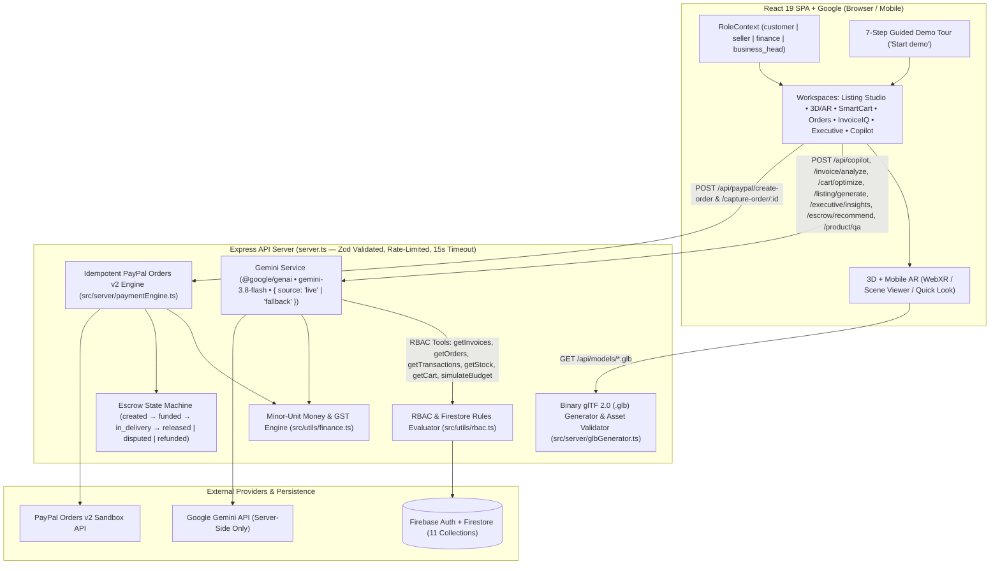

# AC PayPilot — B2B Spatial Commerce, PayPal Sandbox Escrow & Gemini Copilot

AC PayPilot is a role-aware B2B procurement, spatial 3D/AR product inspection, application-level escrow, and GST compliance platform built with **React 19**, **Vite**, **Tailwind CSS v4**, **Node/Express (`server.ts`)**, **Firebase Auth & Firestore**, **PayPal Orders v2 Sandbox**, **Google `<model-viewer>`**, and **server-side `@google/genai` (`gemini-3.8-flash`)**.

---

## Architecture Diagram (Mermaid)



---

## 3-Minute Presentation Script (Guided via the Header **"Start demo"** Button)

Click **"Start demo"** in the top header bar to launch the interactive 7-step guided tour with role-switching and step tooltips:

### Minute 0:00 – 0:45 | Seller Uploads 3D Fan & AI Drafts Listing (`Seller` Role)
1. **Step 1 (`/seller/products` — Seller Listing Studio)**:
   - As **Aarav Sharma (Seller)**, select **AeroBreeze 1200mm BLDC Smart Ceiling Fan (`#FAN-BLDC-892`)**.
   - In the **3D / AR Model Upload (`.glb` / `.gltf` / `.usdz`)** panel, upload or click **"Simulate Valid `aerobreeze-fan.glb` Upload"** to validate file extension and 25 MB limit (`Processing → Ready`).
   - In the **AI Listing Generator (`POST /api/listing/generate`)**, review the three side-by-side columns:
     1. **Provided by Seller** (verbatim facts only)
     2. **Generated by AI** (title, description, tags, FAQs — zero invented dimensions, certifications, or warranty claims)
     3. **Missing Information** (prompts seller to supply missing specs like BIS registration or warranty period)
   - Edit if needed and click **"Approve & Publish Listing"**.

### Minute 0:45 – 1:30 | Customer Inspects `<model-viewer>` 3D/AR & SmartCart (`Customer` Role)
2. **Step 2 (`/customer/product/FAN-BLDC-892` — Customer 3D / AR View)**:
   - As **Priya Patel (Customer)**, inspect the real binary glTF 2.0 3D model of the **AeroBreeze Ceiling Fan** in Google `<model-viewer>`. Use **Rotate**, **Zoom + / -**, and **Reset View**, or switch to the **Badminton Racket (`#SPO-YNX-99P`)**.
   - Switch to **Studio Reference ANC Headphones (`#AUD-ANC-99`)** to verify that when no `.glb` exists, the UI honestly displays **"3D model unavailable"** and falls back to the 2D image gallery (never faking a 3D model from a photo).
   - Scroll to **Customer Product Q&A (`POST /api/product/qa`)** and ask *"Is it waterproof?"* — verify it answers **"not provided"** for attributes absent from stored product data.
3. **Step 3 (`/customer/cart` — SmartCart Optimizer)**:
   - Review the cart containing `#FAN-BLDC-892` and studio hardware.
   - `POST /api/cart/optimize` ranks items against the departmental budget ceiling while keeping **Suggested Alternatives** in a separate approval box. All subtotal, 18% GST, and headroom math is computed in integer minor units (`paise`) via `src/utils/finance.ts`.

### Minute 1:30 – 2:15 | Idempotent PayPal Sandbox Checkout & Seller Escrow (`Customer` → `Seller` Role)
4. **Step 4 (`/customer/cart?modal=checkout` — PayPal Sandbox Checkout)**:
   - Open the PayPal Escrow Checkout Modal. The server (`POST /api/paypal/create-order`) calculates the authoritative total from stored catalog prices in minor units, ignoring any browser-supplied total.
   - Complete the capture (`POST /api/paypal/capture-order/:id`). Double-clicks are protected by idempotency keys.
5. **Step 5 (`/seller/orders` — Seller Order & AI Escrow Release Agent)**:
   - Switch to **Seller**. The order is in `funded` / `in_delivery` escrow state.
   - Review the **AI Escrow Release Agent (`POST /api/escrow/recommend`)** card showing `{ source, recommendation, confidence, reasons[] }`.
   - Click the explicit human confirmation button (**"Mark In Delivery"** / **"1-Click Human Confirm"**) to record an immutable `escrowEvents` entry.

### Minute 2:15 – 3:00 | Finance GST/Payment Audit & Business Head KPIs (`Finance` → `Business Head` Role)
6. **Step 6 (`/finance/ledger` & `/seller/invoices` — Finance Controller)**:
   - Switch to **Rohan Deshmukh (Finance)**. Verify the linked payment settlement and PayPal fee breakdown (shown only when verified from provider data; otherwise `"Not available"`).
   - Open **InvoiceIQ (`POST /api/invoice/analyze`)** to see deterministic code checks for **15-character GSTIN format** and **Place-of-Supply (`CGST + SGST` intra-state vs `IGST` inter-state)** alongside the AI risk score and vendor message draft.
7. **Step 7 (`/executive` — Business Head Command Center)**:
   - Switch to **Vikramaditya Rao (Business Head)**.
   - Toggle date ranges to verify stored-record KPI math (showing `"No baseline"` when the prior comparison window has zero records).
   - Inspect **Validated Executive AI Insights (`POST /api/executive/insights`)**, where every insight cites its supporting metric and record IDs (`ord-1`, `ord-2`, `ord-3`), and forward projections carry an explicit **`Forecast`** badge.

---

## Quick Start & Verification Commands

```bash
# Start full-stack Express + Vite server on port 3000
npm run dev

# Run TypeScript typecheck / linter
npm run lint

# Run unit tests (finance minor-unit math, GSTIN/Place-of-Supply, escrow state machine, idempotent PayPal, RBAC, glTF .glb generator, Gemini fallback/tools)
npm test

# Build production bundle
npm run build
```
